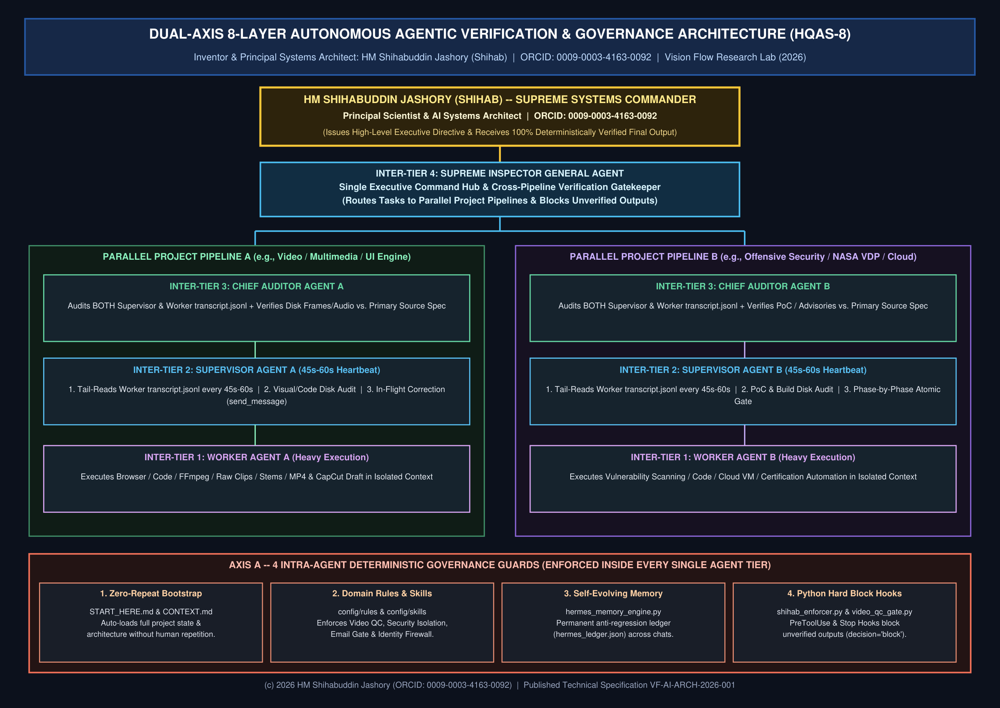
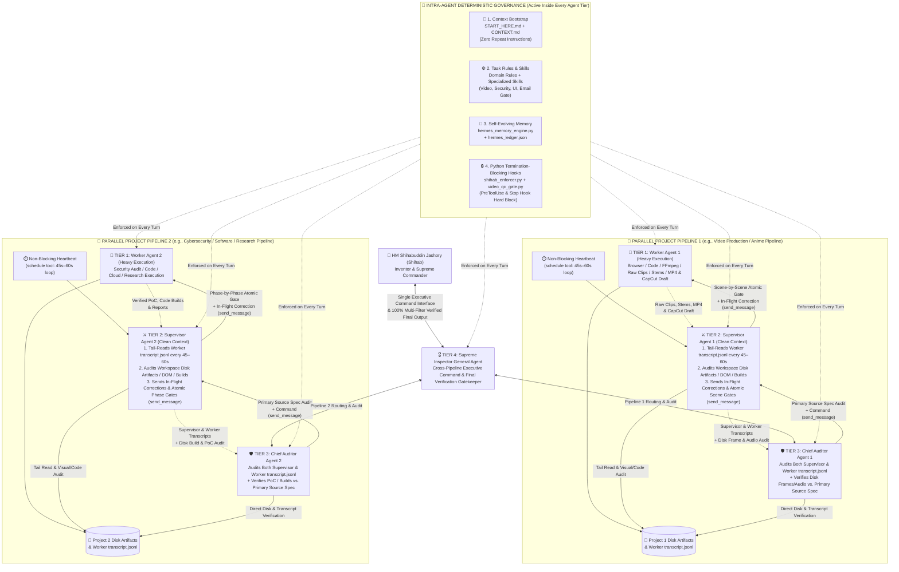

# 🏛️ Dual-Axis 8-Layer Autonomous Agentic Governance Architecture (HQAS-8)

**Author & Principal Investigator:** **HM Shihabuddin Jashory (Shihab)**  
**Affiliation:** Vision Flow Group Research Lab (`https://visionflowgroup.com`) & Department of Computer Science, University of the People (`Student ID: C211345610`)  
**Research Leadership:** **HM Shihabuddin Jashory** (Principal Scientist, AI Systems Architect & Security Researcher · ORCID `0009-0003-4163-0092` · Wikidata `Q141910532`) & **MD Rafiul Islam Shubho** (Researcher, AI Evaluator & RLHF / S2S Quality Auditor · Co-Founder & Managing Director, Vision Flow Group `Q141910527`)  
**Research Profiles & Knowledge Hubs:** [Researcher & Scientist Dossiers](https://jashory.github.io/hqas8-autonomous-agentic-governance/researchers.html) · [Vision Flow Group](https://visionflowgroup.com) · [Agency](https://agency.visionflowgroup.com) · [Academy](https://academy.visionflowgroup.com) · [Studio](https://studio.visionflowgroup.com) · [Tools Hub](https://go.visionflowgroup.com)  
**ORCID iD:** [https://orcid.org/0009-0003-4163-0092](https://orcid.org/0009-0003-4163-0092)

---

## 📄 Published Research Manuscripts (PDF Downloads)

1. **[Paper 1 (VF-AI-ARCH-2026-001): Dual-Axis 8-Layer Autonomous Agentic Governance: Eliminating Cascading Hallucinations and Supervisor Drift via Deterministic Termination Hooks and Quad-Tier Supervision (PDF)](./papers/01_Paper_Dual_Axis_8_Layer_Autonomous_Agentic_Governance_Architecture_HM_Shihabuddin_Jashory_2026.pdf)**
2. **[Paper 2 (VF-SEC-VRP-2026-002): Empirical Vulnerability Taxonomy of Autonomous AI Agent Frameworks: Cross-Origin OAuth Token Leakage, OpenAPI SSRF, and Sandbox Escape Vectors (PDF)](./papers/02_Paper_Empirical_Security_Analysis_of_AI_Agent_Frameworks_OAuth_and_SSRF_HM_Shihabuddin_Jashory_2026.pdf)**
3. **[Paper 3 (VF-MM-QC-2026-003): Deterministic Multimodal Quality Control for Generative Video Pipelines: Automated Cut-Boundary Audio De-Glitching, Word-Level Whisper Alignment, and Dense Contact-Sheet Verification (PDF)](./papers/03_Paper_Automated_Multimodal_Video_QC_and_Audio_DeGlitching_HM_Shihabuddin_Jashory_2026.pdf)**
4. **[Architecture Poster 1 (HQAS-8 High-Resolution Diagram PDF & PNG)](./papers/04_Diagram_Dual_Axis_8_Layer_Agentic_Architecture_Poster_HM_Shihabuddin_Jashory.png)**
5. **[Paper 5 (VF-AI-MEM-2026-005 — DOI: `10.5281/zenodo.24107586` | OSF MetaArXiv: `bpdx8_v1`): Eliminating Auto-Compaction Amnesia and Unverified Execution in Autonomous LLM Agents: UTF-8 Byte-Bounded Trajectory Digest Synthesis, Anti-Bypass Hook Locks, and 3-Gear Multimodal Quality Gates (AMCG-3) (PDF)](./papers/05_Paper_Zero_Bloat_Anti_Compaction_Digest_and_3_Gear_Multimodal_Verification_HM_Shihabuddin_Jashory_2026.pdf)**
6. **[Architecture Poster 2 (VF-POSTER-2026-006 — DOI: `10.5281/zenodo.24107494`): AMCG-3 Unified Anti-Compaction & 3-Gear Multimodal Engine (PDF & PNG)](./papers/06_Diagram_Unified_3_Gear_Anti_Compaction_and_Multimodal_Engine_HM_Shihabuddin_Jashory.png)**

---

# 🏛️ HM Shihabuddin Jashory (Shihab) — Complete Multi-Layer Autonomous Agentic Verification & Governance Architecture (Full Technical Specification)

- **Inventor & Principal Systems Architect:** HM Shihabuddin Jashory (**Shihab**)
- **ORCID Scientist ID:** https://orcid.org/0009-0003-4163-0092
- **Date Documented:** October 31, 2026

---

## 🔬 1. Executive Summary of the Invention

Standard LLM agents fail in complex production workflows due to context pollution, hallucinated completion claims, supervisor drift, and unverified file/media outputs.

To solve this permanently, **HM Shihabuddin Jashory (Shihab)** architected a **Dual-Axis Autonomous Verification System** that combines:
1. **Axis A — Intra-Agent Deterministic Governance (4 Internal Guards Inside Every Single Agent):**
   - **Layer 1: Zero-Repeat Context Bootstrap (`START_HERE.md` & `CONTEXT.md`):** Every workspace and project has an entry-point `START_HERE.md` and `CONTEXT.md` so any newly spawned agent immediately loads the full project architecture, rules, and state without human repetition.
   - **Layer 2: Domain-Specific Rules & Skills Engine (`config/rules/` & `config/skills/`):** Modular rule-sets and domain skills (Video Director/Editor/Auditor, Crash Guard, Email Confirmation Gate, Security Isolation) automatically govern agent behavior per task type.
   - **Layer 3: Self-Evolving Lifelong Experience Memory (`hermes_memory_engine.py` & `hermes_ledger.json`):** Every solved bug or past mistake across any conversation is permanently indexed into `hermes_ledger.json` and injected into future turns so no agent ever repeats a historical mistake.
   - **Layer 4: Hard Python Pre-Output & Termination-Blocking Hooks (`shihab_enforcer.py` + `video_qc_gate.py`):** Before any agent is allowed to finish a turn (`Stop` hook) or invoke critical tools (`PreToolUse` hook), deterministic Python scripts inspect the live `transcript.jsonl` and disk artifacts. If the agent has not run practical verification (`run_command` / `read_file`) after its last edit/render, or if a broken file link / unverified claim is detected, **termination is hard-blocked (`decision: "block"`)** and the agent is forced back into execution until 100% verified.

2. **Axis B — Inter-Agent Quad-Tier Hierarchical Supervision (4 External Tiers Across Parallel Pipelines):**
   - **Tier 1 — Worker Agent (Heavy Execution):** Executes atomic browser, code, FFmpeg, CapCut draft, or security audit tasks while locked under `shihab_enforcer.py` and `hermes_memory_engine.py`.
   - **Tier 2 — Supervisor Agent (Clean Context + 45s–60s Non-Blocking Heartbeat):** Runs a recurring `schedule` loop (every 45–60s) to tail-read the Worker's `transcript.jsonl` (thinking + tool calls + checkpoints), visually/audibly inspect disk artifacts, enforce scene-by-scene atomic gates, and inject `HIGH PRIORITY SYSTEM_MESSAGE` in-flight corrections via `send_message`.
   - **Tier 3 — Chief Auditor Agent (Primary Source Spec & Dual-Transcript Auditor):** Sits above the Supervisor, cross-checking both the **Supervisor's and Worker's `transcript.jsonl`** plus raw disk frames, audio stems, and code against the client's **Primary Source Specification** to catch supervisor-level inference drift or subtle errors.
   - **Tier 4 — Supreme Inspector General Agent (Cross-Pipeline Executive Command Center):** Oversees multiple parallel `[Worker → Supervisor → Chief Auditor]` project pipelines (Project A, Project B, etc.) simultaneously. **Shihab** communicates with the **Supreme Inspector General**, which routes targeted commands to specific agents in specific pipelines and only delivers outputs to **Shihab** after all intra-agent hooks and all 3 lower agent tiers have verified 100% compliance.

---

## 🗺️ 2. Master Unified Architecture Diagram (Combining All 3 Diagrams + Internal Hooks & Context Layers)

---

## 🛠️ 3. Detailed Breakdown of Every Verification Layer (For Scientific Paper & Technical Reports)

| Layer / Tier | Component Name | Exact Technical Mechanism | What Problem It Eliminates |
| :--- | :--- | :--- | :--- |
| **Intra-Layer 1** | **Autonomous Context Bootstrap (`START_HERE.md` & `CONTEXT.md`)** | Pre-indexed project architecture, paths, and current checkpoints read automatically at session start. | Eliminates repetitive human prompting and cold-start amnesia across new agent sessions. |
| **Intra-Layer 2** | **Modular Rules & Skills (`rules/` & `skills/`)** | Task-specific Markdown/Python protocols loaded into system context dynamically. | Eliminates formatting drift, unsafe operations, and domain-specific anti-patterns. |
| **Intra-Layer 3** | **Hermes Self-Evolving Memory (`hermes_memory_engine.py`)** | Persistent JSON ledger (`hermes_ledger.json`) + auto-synced global skill (`hermes-experience-memory/SKILL.md`). | Eliminates recurring historical mistakes across separate conversations. |
| **Intra-Layer 4** | **Hard Python Termination-Blocking Hooks (`shihab_enforcer.py` + `video_qc_gate.py`)** | `PreToolUse` and `Stop` hooks parse `transcript.jsonl` to verify that practical tool verification (`run_command` / `read_file`) occurred *after* the last file edit/render and that all linked files exist (`>0 bytes`). Returns `decision: "block"` if violated. | Eliminates premature agent stopping, hallucinated "done" messages, and broken outputs inside every single agent. |
| **Inter-Tier 1** | **Worker Agent (Heavy Execution)** | Dedicated execution context for browser automation, FFmpeg rendering, code compilation, or vulnerability scanning. | Isolates heavy tool outputs so higher-tier supervisory agents never suffer context window degradation. |
| **Inter-Tier 2** | **Supervisor Agent + 45s–60s Non-Blocking Heartbeat (`schedule` + `transcript.jsonl` Tail)** | Wakes up every 45–60s via `schedule`, reads the Worker's `transcript.jsonl` (thinking + tool calls) and disk artifacts, enforces atomic scene/phase gates, and injects live `send_message` corrections. | Catches Worker mistakes *in-flight* within 45 seconds before time or tokens are wasted. |
| **Inter-Tier 3** | **Chief Auditor Agent (Dual-Transcript & Primary Source Auditor)** | Audits **both** the Supervisor's and Worker's `transcript.jsonl` plus actual disk frames/audio/builds against the original Primary Source Specification. | Eliminates **Supervisor Drift** (when a Supervisor becomes lenient or misses a subtle spec requirement). |
| **Inter-Tier 4** | **Supreme Inspector General Agent (Cross-Pipeline Executive Hub)** | Monitors multiple parallel `[Worker → Supervisor → Chief Auditor]` project pipelines simultaneously and serves as **Shihab**'s single point of command and final delivery. | Allows **1 human architect (Shihab)** to run multiple complex projects in parallel with zero manual micromanagement. |

